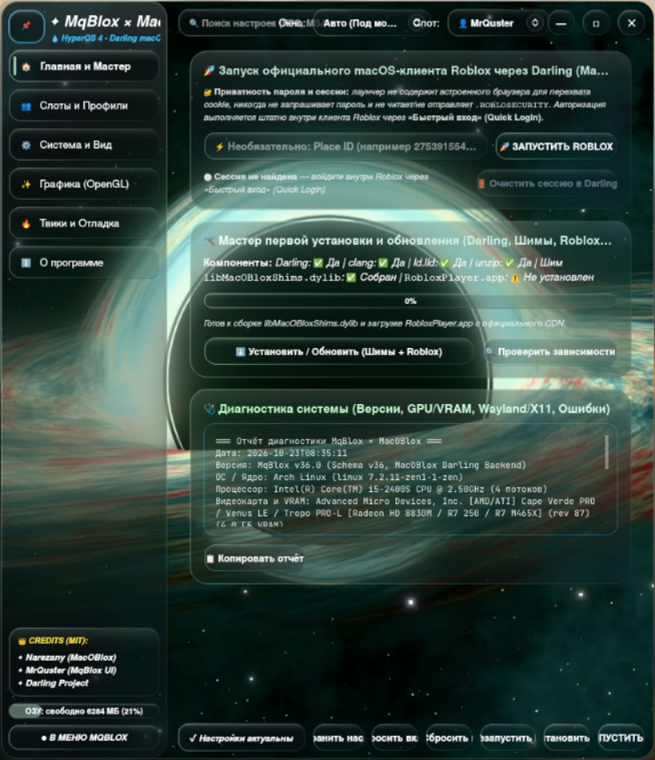

# MqBlox × MacOBlox (v36.0 — HyperOS 4 Liquid Glass + Darling macOS Backend)

[](LICENSE)
[](CMakeLists.txt)
[](packaging/mqblox.desktop)

**MqBlox** — нативный C++20 / Qt6 / OpenGL 3.3 лаунчер в стиле **HyperOS 4 Liquid Glass** (с шейдерным фоном чёрной дыры **TON 618** и единым буфером размытия), подключённый к бэкенду **[MacOBlox](https://github.com/narezy/MacOBlox)** для запуска официального macOS-клиента `RobloxPlayer.app` на Linux через **[Darling](https://www.darlinghq.org/)**.

> **English summary below:** [Jump to English Documentation](#english-documentation)



---

## 🇷🇺 Русская документация

### 1. Архитектура и принципы

- **Только официальные источники (никаких вшитых бинарников)**: репозиторий не содержит бинарных файлов `RobloxPlayer.app`, `Darling` или скомпилированных `.dylib`. Мастер первой установки и обновления скачивает клиент напрямую с официального CDN Roblox (`clientsettingscdn.roblox.com` / `setup.rbxcdn.com`) и собирает шимы локально из исходного кода (`shims/`).
- **Честная работа без обхода античита**: бинарник `RobloxPlayer` не модифицируется и не патчится. Все исправления совместимости со средой Darling (OpenGL Core Profile, IOKit VRAM, `host_statistics64`, `connectx`, DNS-over-TLS, `CoreAudio`, `WM_CLASS`) загружаются через стандартный механизм `DYLD_INSERT_LIBRARIES` (`libMacOBloxShims.dylib`).
- **Приватность пароля и сессии**: лаунчер не запрашивает пароль, не использует встроенный браузер для перехвата cookie, не читает, не логирует и не отправляет `.ROBLOSECURITY`. Авторизация выполняется штатно внутри самого клиента Roblox (через функцию **Быстрый вход / Quick Login**), а сессия хранится локально внутри префикса Darling (`~/.darling/Users/$USER/Library/MacOBlox/`).
- **Чистый тракт звука и микрофона (`shims/audio_hal.c`)**: Qt6-интерфейс лаунчера не вмешивается в PipeWire/PulseAudio/ALSA. Весь ввод и вывод звука работает внутри `shims/audio_hal.c` (CoreAudio HAL + AUHAL Output/Input Bus + `AudioUnitRender`).
- **Оптимизация под Wayland / Hyprland / AMD (`amdgpu`)**:
  - Нативный Wayland-клиент (`app_id = "mqblox"`), сопоставляющий как окно лаунчера, так и XWayland-окно `RobloxPlayer` с единой записью `mqblox.desktop` в доке **[Serpantinum](https://github.com/ilyamiro/serpantinum)**.
  - Ни одного `QGraphicsBlurEffect` на дочерних виджетах (защита от сброса видеодрайвера `amdgpu -12 ENOMEM`): используется единый буфер размытия (`Ton618GlWidget::scaledFrostedBackdrop`).
  - Реальные замеры в простое на Hyprland/Wayland (Arch Linux, ядро `linux-zen`, `amdgpu`):
    - **CPU в простое**: **`0.0%`** (0 тиков планировщика за 3 секунды при статическом фоне или свёрнутом окне).
    - **Память (RSS)**: **`VmRSS = 107 812 КБ` (~`105.3 МиБ`)** с учётом разделяемых библиотек Qt6/Mesa, из них приватная анонимная куча процесса **`RssAnon = 44 196 КБ` (~`43.2 МиБ`)**.

---

### 2. Быстрая установка (One-Command Install)

#### Вариант А: Универсальный скрипт `install.sh` (рекомендуется)
Устанавливает бинарник `mqblox`, собирает `libMacOBloxShims.dylib` и стаб-фреймворки (`CoreML`, `CoreHaptics`, `DeviceCheck`), устанавливает иконки (`hicolor` SVG + PNG `16x16`..`512x512`) и `.desktop`-файл в `~/.local` без прав root:

```bash
curl -fsSL https://raw.githubusercontent.com/MrQuster/mqblox/main/install.sh | bash
```

Локальная установка, обновление или удаление из клонированного репозитория:

```bash
./install.sh install     # Сборка + установка в ~/.local + сборка шимов
./install.sh update      # git pull --ff-only + пересборка и обновление
./install.sh uninstall   # Чистое удаление бинарника, иконок и .desktop (конфиг сохраняется)
```

#### Вариант Б: Пакет Arch Linux (`PKGBUILD` / `makepkg`)
В корне репозитория и в `packaging/arch/PKGBUILD` доступен готовый сценарий сборки пакета для Arch Linux:

```bash
makepkg -si
```

#### Вариант В: Ручная сборка через CMake + Ninja
Зависимости на Arch Linux:
```bash
sudo pacman -S --needed base-devel cmake ninja qt6-base qt6-svg qt6-wayland clang lld unzip hicolor-icon-theme
```
Сборка и запуск тестов:
```bash
cmake -B build -GNinja -DCMAKE_BUILD_TYPE=Release
cmake --build build --parallel
QT_QPA_PLATFORM=offscreen ctest --test-dir build --output-on-failure
./shims/build_debug_shim.sh
```

> **Требование для запуска игры:** установленный **[Darling](https://www.darlinghq.org/)** (`darling-bin` или `darling-git` из AUR). При первом запуске откройте вкладку **«Главная и Мастер»** и нажмите **«Установить / Обновить (Шимы + Roblox)»** — лаунчер скачает свежий `RobloxPlayer.app` с официального CDN Roblox в префикс Darling.

---

### 3. Интеграция с доком Serpantinum и Hyprland

Лаунчер спроектирован с учётом алгоритма сопоставления окон в шелле **Serpantinum** (`WindowTracker.qml` + `AppMatcher.qml`):
- Вызов `QGuiApplication::setDesktopFileName(QStringLiteral("mqblox"))` задаёт нативный Wayland `app_id = "mqblox"`.
- Файл `mqblox.desktop` устанавливается без `NoDisplay=true` и содержит `StartupWMClass=RobloxPlayer`, `Icon=mqblox`, `Categories=Game;`.
- Шим `shims/libMacOBloxShims.m` автоматически выставляет X11 `WM_CLASS` окна `RobloxPlayer` в `mqblox` (`MACOBLOX_WM_CLASS=mqblox`), благодаря чему и нативное Wayland-окно лаунчера, и XWayland-окно игры группируются под одной иконкой **MqBlox** в доке.

---

### 4. Таблица настроек: подтверждённые vs зависящие от белого списка Roblox

Все настройки хранятся в едином реестре `SettingsRegistry` (`~/.config/mqblox/settings_v36.json`, `schemaVersion = 36`) с атомарной записью через `QSaveFile` и автоматической миграцией со старых схем (`settings_v35.json`, `settings_v34.json`, `settings_v13.json`).

Перед запуском игры `SoberController::syncConfigFromSettings()` генерирует:
1. Переменные окружения процесса Darling (`MACOBLOX_*`, `__GL_*`, `vblank_mode`);
2. `ClientAppSettings.json` внутри бандла `RobloxPlayer.app/Contents/MacOS/ClientSettings/ClientAppSettings.json` и в профиле слота.

| Ключ в `SettingsRegistry` | Куда записывается | Статус работы в macOS-клиенте |
| :--- | :--- | :--- |
| `vramLimitGib` | `export MACOBLOX_VRAM_MB=<GiB*1024>` (`shims/gpu_info.c`) | **Подтверждено** — напрямую перехватывается в `shims/gpu_info.c` (IOKit `VRAM,totalsize`). |
| `glCore33` | `export MACOBLOX_GL_CORE33=0\|1` (`shims/gl_profile.c`) | **Подтверждено** — переключает профиль CGL между OpenGL 3.3 Core и OpenGL 4.1 Core в `shims/gl_profile.c`. |
| `dnsCustomResolver` | `export MACOBLOX_DNS_UPSTREAM=host:port` (`shims/dns_override.c`) | **Подтверждено** — задаёт адрес локального DNS-прокси для `shims/dns_override.c`. |
| `vsync` | `export vblank_mode=0\|1`, `__GL_SYNC_TO_VBLANK=0\|1` | **Подтверждено на уровне драйвера Mesa/NVIDIA** для XWayland-окна. |
| `lightingTechnology` | `FFlagDebugForceFutureIsBrightPhase3` / `Phase2` (`ClientAppSettings.json`) | **Подтверждено в MacOBlox** (`launcher/config.py`: `lighting_technology`). |
| `msaa` | `FIntDebugForceMSAASamples` (`ClientAppSettings.json`) | **Подтверждено в MacOBlox** (`launcher/config.py`: `msaa_samples`). |
| `textureQuality` | `DFIntTextureQualityOverride` (`ClientAppSettings.json`) | **Подтверждено в MacOBlox** (`launcher/config.py`: `texture_quality`). |
| `disablePostFx` | `FFlagDisablePostFx` (`ClientAppSettings.json`) | **Подтверждено в MacOBlox** (`launcher/config.py`: `disable_postfx`). |
| `debugSkyGray` | `FFlagDebugSkyGray` (`ClientAppSettings.json`) | **Подтверждено в MacOBlox** (`launcher/config.py`: `gray_sky`). |
| `fpsLimit` | `DFIntTaskSchedulerTargetFps` (`ClientAppSettings.json`) | **Подтверждено в MacOBlox** (`launcher/config.py`: `fps_limit`). На новых релизах Roblox может требовать выбора лимита в меню самой игры. |
| `graphicsQuality` | `FIntRomarkStartWithGraphicQualityLevel` (`ClientAppSettings.json`) | **Предположительно (зависит от белого списка FFlag клиента Roblox)** — может игнорироваться современным клиентом. |
| `disableShadows` | `FIntRenderShadowIntensity` (`ClientAppSettings.json`) | **Предположительно (зависит от белого списка FFlag клиента Roblox)** — может игнорироваться клиентом. |
| `renderDistance` | `DFIntDebugFRMQualityLevelOverride` (`ClientAppSettings.json`) | **Предположительно (зависит от белого списка FFlag клиента Roblox)** — может игнорироваться клиентом. |
| `grassMovement` | `FIntFRMMinGrassDistance` / `FIntFRMMaxGrassDistance` | **Предположительно (зависит от белого списка FFlag клиента Roblox)** — может игнорироваться клиентом. |
| `customFastFlags` | Произвольный JSON-объект в `ClientAppSettings.json` | **Зависит от белого списка клиента Roblox** — применяются только разрешённые клиентом ключи. |

*(Настройки старого Android/Sober-бэкенда — `touchMode`, `bringBackOof`, `useOpengl`, `enableGamemode`, `discordRpc` — удалены из активной конфигурации как неприменимые к macOS-клиенту).*

---

### 5. Звук, микрофон (`shims/audio_hal.c`) и проверка в игре

Весь звуковой тракт работает исключительно внутри `shims/audio_hal.c`. В этом форке в `audio_hal.c` внесены 4 ключевых исправления захвата микрофона (AUHAL Input Bus 1):
1. Устранён возврат ошибки `-50` (`paramErr`) при `kAudioUnitProperty_StreamFormat` (`SetProperty`) на шине захвата `scope == kAudioUnitScope_Input && element == 1`.
2. При создании `AudioUnit` формат `in_stream_format` инициализируется в стандартный для macOS Voice Chat **Float32 48000 Hz Mono**, а не `S16_LE`.
3. В `MacOBloxAudio_Render` исправлено вычисление адреса буфера `AudioBufferList` при `mNumberBuffers > 1` (неперемежающиеся каналы) и добавлена конвертация `S16_LE -> Float32` при различии форматов ALSA и клиента.
4. Исправлена формула порога гистерезиса кольцевого буфера микрофона (`cap_prebuffered`), из-за которой захват на части гарнитур никогда не стартовал при буфере ALSA `<= 60 мс`.

#### Как протестировать микрофон в игре с журналированием `MACOBLOX_AUDIO_LOG`
В `shims/audio_hal.c` встроено опциональное потокобезопасное журналирование через переменную окружения `MACOBLOX_AUDIO_LOG` (`1`/`stderr` для вывода в консоль или путь к файлу):

```bash
MACOBLOX_AUDIO_LOG=/tmp/macoblox_audio.log mqblox
```

1. Запустите `mqblox` с переменной `MACOBLOX_AUDIO_LOG=/tmp/macoblox_audio.log`.
2. Войдите в плейс с поддержкой **Roblox Voice Chat** и включите иконку микрофона над персонажем.
3. Проверьте лог:
   ```bash
   tail -f /tmp/macoblox_audio.log
   ```
   Вы должны увидеть строки инициализации `AudioUnitInitialize`, установку `SetProperty StreamFormat` на `element=1`, запуск потока `capture_thread_fn: ALSA capture started` и периодическую статистику `Render(Input): calls=... frames=... ring_avail=...`.

---

## English Documentation

### Overview
**MqBlox v36.0** is a native **C++20 / Qt6 / OpenGL 3.3** launcher featuring a **HyperOS 4 Liquid Glass** UI (with a real-time **TON 618** black hole GLSL backdrop and a single shared frosted-glass blur buffer), powered by the **[MacOBlox](https://github.com/narezy/MacOBlox)** backend to run the official macOS `RobloxPlayer.app` client on Linux through **[Darling](https://www.darlinghq.org/)**.

### Key Highlights
- **Official Sources Only**: No bundled `RobloxPlayer.app`, `Darling`, or prebuilt `.dylib` binaries in the repository. The built-in Setup Wizard downloads `RobloxPlayer.app` directly from Roblox's official CDN (`clientsettingscdn.roblox.com` / `setup.rbxcdn.com`) and compiles `libMacOBloxShims.dylib` locally.
- **Zero Anti-Cheat Tampering**: `RobloxPlayer` is never patched or modified. Compatibility fixes (OpenGL Core Profile, IOKit VRAM reporting, `host_statistics64`, `connectx`, DNS-over-TLS, `CoreAudio`, X11 `WM_CLASS`) are injected cleanly via `DYLD_INSERT_LIBRARIES`.
- **Session & Password Privacy**: MqBlox never asks for your password, has no embedded browser, and never reads, logs, or transmits `.ROBLOSECURITY`. Sign in directly inside the Roblox client using **Quick Login**.
- **Idle Efficiency on Wayland / Hyprland**: Measured **`0.0%` CPU** at idle and **`105.3 MiB` total `VmRSS`** (`43.2 MiB` private `RssAnon`) on Arch Linux (`Hyprland`, `amdgpu`).

### Quick Install
```bash
curl -fsSL https://raw.githubusercontent.com/MrQuster/mqblox/main/install.sh | bash
```
Or on Arch Linux via `makepkg`:
```bash
makepkg -si
```

---

## Credits & License

Licensed under the **MIT License** (see [`LICENSE`](LICENSE)):

- **[Narezany (`narezy`) — MacOBlox](https://github.com/narezy/MacOBlox)** (`Copyright (c) 2026 Narezany`, MIT License) — original creator of MacOBlox, the Darling runtime architecture for macOS Roblox on Linux, all C/Objective-C Darwin shims (`libMacOBloxShims.m`, `audio_hal.c`, `gl_profile.c`, `gpu_info.c`, `memory_stats.c`, `dns_override.c`, `darling_fixes.c`, `xfixes_raw.c`, `net_trace.c`, `fast_libc.c`, `xattr_compat.c`, `exit_compat.c`, `connectx_compat.c`, `missing_symbols.c`), stub frameworks (`CoreML`, `CoreHaptics`, `DeviceCheck`), and the DNS-over-TLS proxy.
- **[Darling Project](https://www.darlinghq.org/)** — macOS / Darwin translation layer for Linux.
- **[MrQuster — MqBlox](https://github.com/MrQuster/mqblox)** (`Copyright (c) 2026 MrQuster`, MIT License) — C++20/Qt6 HyperOS 4 Liquid Glass interface, `Ton618GlWidget` OpenGL shader engine, unified `SettingsRegistry`, setup wizard, system diagnostics, Serpantinum dock integration, and microphone capture fixes in `shims/audio_hal.c`.
